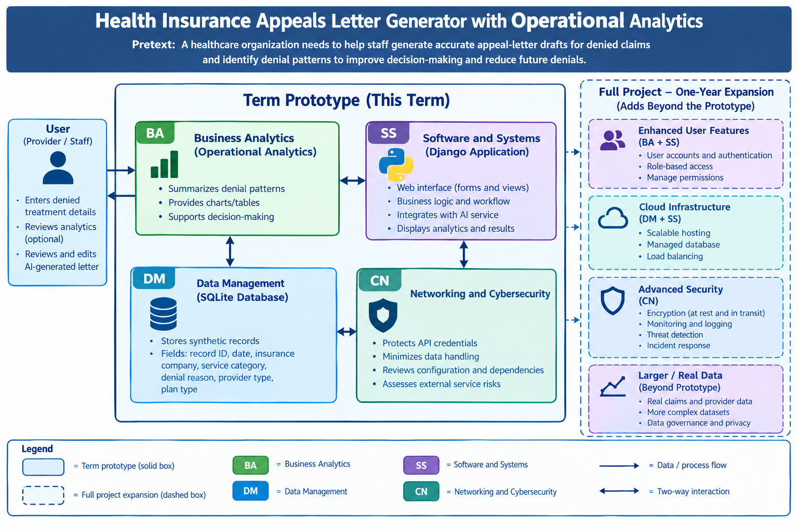

# First Draft of Capstone Project Proposal: Health Insurance Appeals Letter Generator and Operational Analytics

## 1. Pretext
Health insurance denials can be confusing and stressful for patients and health insurance organizations. This prototype will be a small web application that helps users prepare an appeal letter draft with AI assistance. Users will review and edit the draft before finalizing it. The application will not submit appeals or make medical or coverage decisions. Basic operational analytics will explore patterns in denial records that could help health organizations identify areas for further investigation.

## 2. Process Flow
-Software and Systems (SS): A Django web application provides the user interface, workflow, AI integration, and results. Without SS, there is no working prototype.
-Data Management (DM): SQLite stores a small synthetic dataset for analysis. Without DM, the records could not be consistently stored and analyzed.
-Business Analytics (BA): Python summarizes denial patterns by denial reason and service category and presents simple tables or charts. Without BA, the prototype would not provide its operational analytics.
-Cybersecurity (CN): CN guides data minimization, API credential protection, and consideration of risks from application dependencies and external services. Without CN, the prototype would not demonstrate responsible security practices.

The prototype path is user input → SS/Django → AI-assisted draft → user review/edit → DM/SQLite → BA/operational analytics with CN applied throughout.

## 3. Synthesis Prototype
The prototype will be a new Django web application built from end-to-end.
Inputs: Approximately 30–50 synthetic records representing a limited prototype period with fields for synthetic record ID, date created, insurance company name, service category, denial reason, provider type, and plan type. The user will also enter information about a denied service for the appeal letter workflow.
Processing: SS manages the application and user workflow. DM stores the synthetic records in SQLite. BA uses Python to summarize denial patterns by denial reason and service category. An existing language model API generates an initial appeal letter draft for human review and editing. CN guides credential protection and data minimization.
Outputs: An AI assisted appeal letter draft and operational analytics showing trends/patterns.
Interface: Django web application using HTML/Django templates.
Complete path: A user enters denied service information, receives an AI assisted draft appeals letter, reviews and edits it, and backend views of analytics based on the synthetic SQLite records.

## 4. Full Project
The full project is a larger one year expansion of the prototype. It could add user accounts and authentication, role based access, cloud infrastructure, stronger security controls, larger or authorized organizational datasets, additional data governance, and enhanced operational analytics. Real healthcare information would require appropriate privacy protections, access controls, security assessment, and organizational oversight.

## 5. Data
Source	Authority	Grain	Access	Terms
Project created synthetic denial dataset	Project author	One synthetic denial record	Created locally and stored with the project	Synthetic data - no real patient or insurance records
Public CMS documentation used to inform terminology	Centers for Medicare & Medicaid Services	Reference information for denial/review categories	Public documentation	Used for reference - not the prototype dataset
The synthetic dataset is relevant as it provides the records needed to demonstrate the analytics. Accountability comes from documenting that the records are project created and not actual insurer activity. The dataset will be available locally and checked for missing or inconsistent values. It will not contain personal information for purposes of this prototype - names, addresses, dates of birth, member IDs, claim numbers, MRNs, SSNs, diagnoses, or detailed medical histories. Considered for long-term expansion. The synthetic records are not intended to represent actual/specific insurance company behavior.

## 6. Tools and Platform
The prototype will use Python, Django, SQLite, HTML/Django templates, Python data analysis tools, and an existing language model API. The application will run locally and will not require cloud deployment.

## 7. Risks and First Milestone
Key risks include AI generated text that will require human review and drawing conclusions from small counts. I will address these by requiring user review, documenting the dataset's limitations, and presenting summaries as exploratory rather than conclusive. My first milestone is to create the Django project and a working input form, then add letter drafting and analytics incrementally.

## 8. Evidence I Build On
-Capstone/BA/evolution.md and its supporting Business Analytics artifacts
-Capstone/DM/evolution.md and artifacts/CIDM-6350/Schema.drawio.pdf
-Capstone/SS/evolution.md and prior HealthAppeals coursework artifacts
-Capstone/CN/evolution.md, artifacts/CIDM-6340/AuditPlan.pdf, and artifacts/CIDM-6341/SecurityReport.pdf

The capstone addresses a weakness identified in the appraisals: integrating the four curricular areas into one coherent application. My previous HealthAppeals project provides evidence of developing Django skills. However, this capstone will be a new project built from end-to-end with incorporation of all four pillars.

## 9. AI Use
I expect to use AI for troubleshooting review, formatting, and project organization. An existing language model API will generate initial appeal letter drafts from user provided denial information. AI generated drafts will require human review and editing, and AI use will be documented accordingly and as instructed. 
